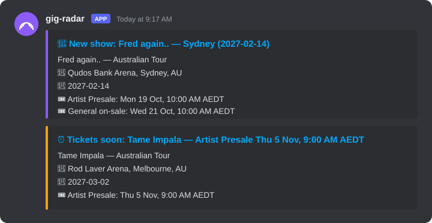
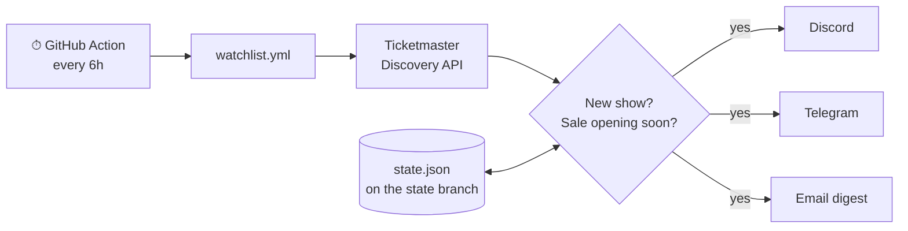

<div align="center">

# 📡 gig-radar

**Get told about gigs *before* the tickets drop, not after they sell out.**

[](https://github.com/SmitHunter/gig-radar/actions/workflows/ci.yml)




<sub>Example alerts, shown in Discord. Telegram and email get the same info.</sub>

</div>

---

## The problem

Spotify told me about a gig **after** it had sold out. Bandsintown and Songkick are better, but they:

- tell you a show was **announced**, not **when tickets go on sale**, and the presale is the part that matters;
- mostly track your **home city**, not "anywhere in Australia";
- want another app, another account, and another inbox to check.

## The fix

You list your artists in one file. A free GitHub Action checks Ticketmaster every 6 hours, and you get **two pings per show**:

| When | Alert |
|---|---|
| 🎤 Show is announced | Artist, venue, city, date, **every presale + on-sale time**, ticket link |
| ⏰ ~24h before tickets open | "Artist Presale opens Thu 5 Nov, 9:00 AM. Set an alarm." |

No server, no app, no database. You're never told twice about the same thing.

## Setup (about 5 minutes)

**1. Fork this repo**, then open the **Actions** tab and click *"I understand my workflows, go ahead and enable them"*.

**2. Edit [`watchlist.yml`](watchlist.yml)**, right on GitHub:

```yaml
artists:
  - Fred again..
  - Tame Impala
countries: [AU]        # or NZ, GB, US, ... as many as you like
cities: []             # optional, e.g. [Sydney, Melbourne]
remind_hours_before: 24
```

**3. Add secrets** in *Settings → Secrets and variables → Actions*:

| Secret | Where to get it |
|---|---|
| `TICKETMASTER_API_KEY` | **Required.** Free at [developer.ticketmaster.com](https://developer.ticketmaster.com/): sign up, then copy the *Consumer Key* |
| `DISCORD_WEBHOOK_URL` | Discord channel → *Edit Channel → Integrations → Webhooks → New Webhook → Copy URL* |
| `TELEGRAM_BOT_TOKEN` + `TELEGRAM_CHAT_ID` | Make a bot with [@BotFather](https://t.me/BotFather), message it once, then read your chat ID from `https://api.telegram.org/bot<TOKEN>/getUpdates` |
| `SMTP_HOST` `SMTP_USER` `SMTP_PASSWORD` `EMAIL_TO` | Gmail: `smtp.gmail.com` + an [app password](https://myaccount.google.com/apppasswords). `SMTP_PORT` is optional (default 465) |

Add only the channels you want; each one turns on when its secrets are set.

**Test it:** Actions → **watch** → **Run workflow**. Your first alerts land within a minute.

> 🕐 Alert times default to Sydney time. Change it under *Variables*: add `TIMEZONE`, e.g. `Pacific/Auckland` or `Europe/London`.

## How it works



1. **Find the artist, not the keyword.** Each name is matched to a Ticketmaster *attraction* first, so a search for "Muse" doesn't return museum tours.
2. **Normalise.** Every presale and the public on-sale become a sorted list of `SaleWindow`s.
3. **Diff against memory.** `state.json` records the shows and reminders already sent. It lives on a separate `state` branch, so `main` stays clean and forks start fresh.
4. **Notify, then remember.** State is saved only once at least one channel delivered, so a Discord outage never loses an alert.

```
gig_radar/
├── config.py               # watchlist.yml → validated settings (pydantic)
├── sources/ticketmaster.py # API client: artist match, events, sale windows
├── diff.py                 # what's new / what's opening soon + state
├── notify/                 # discord · telegram · email (auto-enabled by secrets)
└── main.py                 # fetch → diff → notify → save
```

## How it compares

| | gig-radar | Bandsintown / Songkick | Spotify emails |
|---|:-:|:-:|:-:|
| Alert when a show is announced | ✅ | ✅ | ✅ (often late) |
| **Reminder before presale / on-sale** | ✅ | sometimes | ❌ |
| Whole country(s), not just your city | ✅ | partly | ❌ |
| Alerts in Discord / Telegram | ✅ | ❌ | ❌ |
| Share alerts with friends (group chat) | ✅ | ❌ | ❌ |
| Open source, $0, no account | ✅ | ❌ | ❌ |

## Run it locally

```bash
git clone https://github.com/SmitHunter/gig-radar && cd gig-radar
python -m venv .venv && source .venv/bin/activate   # Windows: .venv\Scripts\activate
pip install -e ".[dev]"

pytest                                   # 10 tests, no network needed
TICKETMASTER_API_KEY=xxx python -m gig_radar --dry-run   # print alerts, send nothing
```

## Limits (honest ones)

- **Ticketmaster only, for now.** In Australia, shows ticketed only through Ticketek, Moshtix or Oztix won't appear yet.
- **Presale codes aren't in the API.** You get the presale *time*; the code still comes from the artist's mailing list. Sign up there too.
- Free API key: 5,000 calls/day. 20 artists checked every 6h uses about 160.
- GitHub pauses scheduled workflows in repos with no activity for 60 days. It emails you first, and one click turns them back on.

## Roadmap

- [ ] More sources: Bandsintown, Ticketek
- [ ] `.ics` calendar feed of every on-sale time
- [ ] "Similar artists touring near you" from your Spotify top artists

## License

MIT. Fork it, break it, catch the gig.
