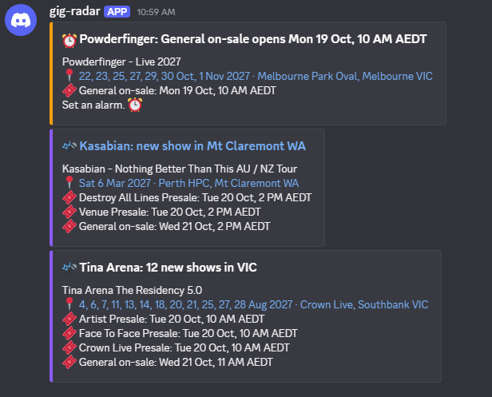
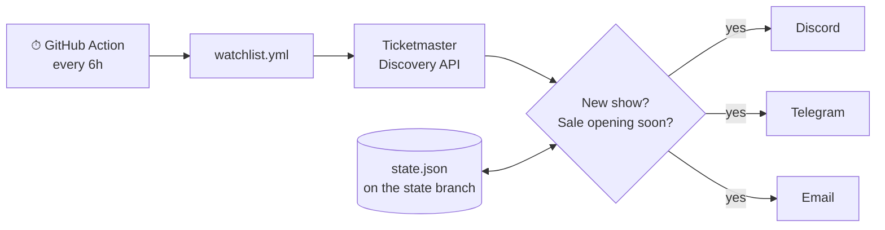

<div align="center">

# 📡 gig-radar

**Get a Discord ping when your favourite artists announce shows, and again before tickets go on sale.**<br>
Free. No app, no server. Set up in about 5 minutes.

[](https://github.com/SmitHunter/gig-radar/actions/workflows/ci.yml)




<sub>Real alerts from a run on 18 Oct 2026.</sub>

</div>

---

## Set it up

You need a GitHub account and a Discord server. Telegram and email work too ([see below](#other-alert-channels)).

### 1. Copy this repo

Click **[Fork](https://github.com/SmitHunter/gig-radar/fork)**, then **Create fork**.

In your fork, open the **Actions** tab and click **"I understand my workflows, go ahead and enable them"**.

### 2. Get a free Ticketmaster key

1. Sign up at **[developer.ticketmaster.com](https://developer.ticketmaster.com/)**.
2. Click your name (top right) → **My Apps** → open the app that's already there.
3. Copy the **Consumer Key**.

### 3. Get a Discord webhook

In Discord, pick a channel → ⚙️ **Edit Channel** → **Integrations** → **Webhooks** → **New Webhook** → **Copy Webhook URL**.

### 4. Paste both into your fork

In your fork: **Settings** → **Secrets and variables** → **Actions** → **New repository secret**. Add two:

| Name | Value |
|---|---|
| `TICKETMASTER_API_KEY` | the Consumer Key from step 2 |
| `DISCORD_WEBHOOK_URL` | the webhook URL from step 3 |

### 5. Pick your artists

Open **[`watchlist.yml`](watchlist.yml)** in your fork, click ✏️, and swap in your artists:

```yaml
artists:
  - Spacey Jane
  - Bruno Mars
countries: [AU]
```

Click **Commit changes**.

### 6. Test it

**Actions** → **watch** → **Run workflow**. Alerts land in Discord within a minute.

✅ **Done.** From now on it checks every 6 hours by itself.

---

## Options

All in `watchlist.yml`:

| Setting | Example | What it does |
|---|---|---|
| `artists` | `[Spacey Jane, Bruno Mars]` | Who to watch |
| `countries` | `[AU, NZ]` | Country codes to search |
| `cities` | `[VIC, NSW]` | Only these places. Use **state codes**: Ticketmaster lists suburbs, so "Melbourne" would miss Marvel Stadium (Docklands). Leave empty for everywhere |
| `remind_hours_before` | `24` | How early the "tickets open soon" reminder comes |

Times show in Sydney time. To change it: **Settings** → **Secrets and variables** → **Actions** → **Variables** tab → add `TIMEZONE`, e.g. `Australia/Perth` or `Pacific/Auckland`.

### Other alert channels

Add the secrets for any channel you want. Each one turns on when its secrets are set.

<details>
<summary><b>Telegram</b></summary>

1. Message [@BotFather](https://t.me/BotFather) → `/newbot` → copy the token.
2. Send your new bot any message.
3. Open `https://api.telegram.org/bot<TOKEN>/getUpdates` and copy the `chat` → `id` number.
4. Add secrets `TELEGRAM_BOT_TOKEN` and `TELEGRAM_CHAT_ID`.

</details>

<details>
<summary><b>Email (Gmail)</b></summary>

1. Make an [app password](https://myaccount.google.com/apppasswords) (needs 2-step verification on).
2. Add secrets: `SMTP_HOST` = `smtp.gmail.com`, `SMTP_USER` = your Gmail address, `SMTP_PASSWORD` = the app password, `EMAIL_TO` = where to send alerts.

You get one digest email per run.

</details>

---

## What you get

| When | Message |
|---|---|
| 🎤 An artist announces shows | One message per artist: every venue with its dates, every presale and on-sale time (split by state when they differ), ticket links |
| ⏰ ~24h before tickets open | "Powderfinger: General on-sale opens Mon 19 Oct, 10 AM AEDT. Set an alarm." |

You're never told twice about the same thing.

## How it works



1. **Find the artist, not the keyword.** Each name is matched to a Ticketmaster *attraction* first, so "Muse" doesn't return museum tours.
2. **Collect every ticket release.** Each presale and the public on-sale becomes a `SaleWindow`. On-sale times often differ by state, so they stay tied to their shows.
3. **Compare with memory.** `state.json` records which shows and reminders were already sent. It lives on a separate `state` branch, so `main` stays clean and forks start fresh.
4. **Group, send, then remember.** Alerts are grouped into one message per artist. State is saved only after at least one channel delivers, so an outage never loses an alert.

```
gig_radar/
├── config.py               # watchlist.yml → validated settings (pydantic)
├── sources/ticketmaster.py # API client: artist match, events, sale windows
├── diff.py                 # what's new / what's opening soon + state
├── models.py               # Event, SaleWindow, per-artist Digest
├── notify/                 # discord · telegram · email (auto-enabled by secrets)
└── main.py                 # fetch → diff → group → notify → save
```

### Run it locally

```bash
git clone https://github.com/SmitHunter/gig-radar && cd gig-radar
python -m venv .venv && source .venv/bin/activate   # Windows: .venv\Scripts\activate
pip install -e ".[dev]"

pytest                                                   # no network needed
TICKETMASTER_API_KEY=xxx python -m gig_radar --dry-run   # print alerts, send nothing
```

## Why I built it

Spotify told me about a gig **after** it had sold out. Good gig apps exist, but their alerts live inside *their* app or *their* emails and get lost. I wanted alerts in the places my mates and I already talk, on a schedule I control, from code I can read.

For most people an app is enough, so here's an honest comparison:

| | gig-radar | Gig apps |
|---|:-:|:-:|
| Alerts in **your Discord server or Telegram group**, so mates see them together | ✅ | ❌ |
| Open source, self-hosted, no account, no tracking, $0 | ✅ | ❌ |
| Your own rules: countries, states, how early to remind | ✅ | partly |
| Covers every Australian ticket site | ❌ Ticketmaster only | ✅ [Whatslively](https://whatslively.com/) |

Also worth knowing: **Bandsintown** and **Songkick** (follow artists, get alerted near you) and **Ticketmaster Favourites** (Ticketmaster events only).

## Limits

- **Ticketmaster only.** Ticketek and Oztix only give API access to approved partners, and I found no public Moshtix API. gig-radar uses official APIs only and doesn't scrape. Adding a source is one file in `gig_radar/sources/`.
- **No presale codes.** You get the presale *time*; codes still come from the artist's mailing list.
- **Free key limit:** 5,000 calls/day. 20 artists every 6h uses about 160.
- **GitHub pauses schedules** in repos with no activity for 60 days. It emails you first; one click turns it back on.

## Roadmap

- [ ] More sources, where an official API allows it
- [ ] `.ics` calendar feed of every on-sale time
- [ ] Suggest artists from your Spotify top artists

## License

MIT. Fork it, break it, catch the gig.
